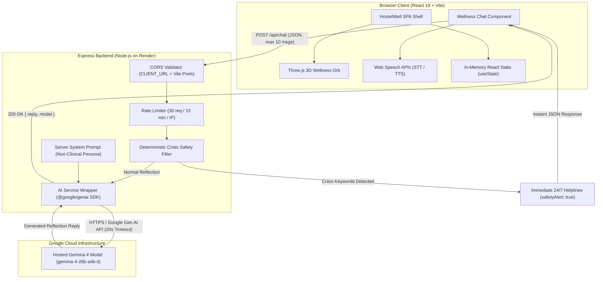

# HostelWell — Find Your Balance 🏡🌱

[](LICENSE)
[](https://react.dev/)
[](https://vitejs.dev/)
[](https://nodejs.org/)
[](https://expressjs.com/)
[](https://ai.google.dev/)

> **A privacy-conscious daily wellness reflection platform and AI companion engineered for college students navigating shared and private hostel living.**

---

## 📌 Project Deployment

* **Frontend Application:** [https://private-hostel-students-wellness-checker-8y0ejsid3.vercel.app](https://private-hostel-students-wellness-checker-8y0ejsid3.vercel.app)
* **Backend Health Endpoint:** [https://hostelwell-backend.onrender.com/api/health](https://hostelwell-backend.onrender.com/api/health)

> *Deployment Note:* The backend service is hosted on Render's free tier. If the instance has been inactive, the initial request may experience a cold-start delay (~30–50 seconds) while the container spins up.

---

## 📖 Table of Contents

- [Overview](#-overview)
- [Problem Statement](#-problem-statement)
- [Key Features](#-key-features)
- [Visual Design & Aesthetics](#-visual-design--aesthetics)
- [Technology Stack](#-technology-stack)
- [Application Architecture](#-application-architecture)
- [Authentication & Security Status](#-authentication--security-status)
- [Privacy & Data Handling Model](#-privacy--data-handling-model)
- [Prerequisites](#-prerequisites)
- [Installation & Local Setup](#-installation--local-setup)
- [Environment Configuration](#-environment-configuration)
- [Running the Application](#-running-the-application)
- [API Reference](#-api-reference)
  - [`GET /api/health`](#1-health-check-get-apihealth)
  - [`POST /api/chat`](#2-wellness-chat-post-apichat)
- [Deployment Guide](#-deployment-guide)
  - [Frontend (Vercel)](#frontend-deployment-vercel)
  - [Backend (Render)](#backend-deployment-render)
- [Repository Structure](#-repository-structure)
- [Known Limitations](#-known-limitations)
- [Roadmap & Future Enhancements](#-roadmap--future-enhancements)
- [Contributing](#-contributing)
- [License](#-license)

---

## 🌿 Overview

Living in a college hostel away from family is a transformative experience, but it introduces distinct physical and emotional stressors: noisy corridors, shared washrooms, academic pressure, homesickness, erratic sleep cycles, and mess food fatigue.

**HostelWell** is an approachable, zero-barrier wellness reflection application built specifically for this student lifestyle. It gives students a private space to log daily check-ins, observe rolling stress and energy trends, explore guided journaling prompts, access verified 24/7 crisis helplines, and converse with an empathetic, non-clinical AI reflection companion powered by Google's hosted **Gemma 4** open model.

---

## 🎯 Problem Statement

Traditional mental health and habit-tracking apps often fail hostel students due to three friction points:

1. **Intrusive Data Demands:** Requiring mandatory account creation, email sign-ups, and long onboarding questionnaires deters students who fear their emotional state could be exposed to peers or administrators.
2. **Clinical & Disconnected Tone:** Many tools pathologize normal transitional friction with clinical psychiatric terminology or dismiss genuine struggles with toxic positivity.
3. **Lack of Hostel Context:** Generic wellness apps do not account for the realities of shared dormitory life—such as midnight roommate conflicts, exam preparation weeks, communal dining, or curfew constraints.

HostelWell resolves this by operating with an **in-memory, privacy-first model** and contextualizing reflections around practical, low-barrier hostel actions (e.g., stepping onto a campus green, washing one's face, making tea, or taking a five-minute breather).

---

## ✨ Key Features

### 1. Multi-Factor Daily Check-In
* **Three-Pillar Assessment:** Log daily **Mood** (5 expressive states: *Great*, *Good*, *Okay*, *Low*, *Overwhelmed*), **Stress Level** (1–5 scale: *Very Low* to *Extreme*), and **Energy Level** (1–5 scale: *Exhausted* to *High*).
* **Optional Reflection Notes:** Add a personal journal note (up to 500 characters) describing daily triggers or accomplishments.
* **Dynamic Calendar State:** Automatically evaluates against the user's local date (`YYYY-MM-DD`), immediately reflecting whether today's check-in has been completed.

### 2. Interactive 3D Wellness Orb (Three.js WebGL)
* **Custom Visual Centerpiece:** Pure Three.js WebGL canvas featuring an electric blue (`#1677FF`) and bright cyan (`#00C2FF`) luminous physical sphere with dual gyroscopic orbital rings.
* **Constellation Particles:** Luminous orbiting particle network rotating in responsive 3D space.
* **Cursor Parallax Tracking:** Subtle pointer tracking responds smoothly to desktop mouse coordinates.
* **Performance Optimization:** Managed with an `IntersectionObserver` that pauses the animation loop when scrolled off-screen (0% idle GPU usage) and gracefully respects `prefers-reduced-motion`.

### 3. Analytics & Check-In History
* **Metrics & Rolling Averages:** Real-time dashboard displaying current check-in streak, today's status, and calculated 7-day rolling averages for stress and energy.
* **Visual Trend Graphs:** Comparative bar visualizations contrasting daily stress vs. energy levels.
* **Mood Distribution:** Breakdown of logged emotional states over recorded check-ins.
* **Synthetic Demo Records:** Pre-seeded with 6 realistic demo entries (`isSynthetic: true`) so students can immediately explore charts upon first launch. Demo entries are prominently tagged with a **Demo Record** badge.

### 4. Guided Reflection Prompts
* Curated self-reflection prompts categorized by authentic hostel challenges:
  * **Roommate Dynamics:** Setting healthy boundaries in shared living spaces.
  * **Academic Pressure:** Managing syllabus coverage, deadlines, and exam anxiety.
  * **Sleep & Routine:** Navigating irregular schedules and late-night hostel noise.
  * **Homesickness:** Adapting to independence, missing home, and mess food adjustments.
  * **Gratitude:** Celebrating small daily victories and resilience.

### 5. Verified 24/7 Helpline Directory
* Direct, one-tap access to verified, confidential, toll-free Indian support helplines:
  * **Tele-MANAS (Govt. of India):** Dial `14416` or `1800 891 4416` (24/7, 20+ languages).
  * **KIRAN Mental Health Helpline:** Dial `1800-599-0019` (Govt. of India, Dept. of Empowerment).
  * **National Emergency Helpline:** Dial `112` (All-in-one Police, Medical, Fire).

### 6. AI Reflection Companion (Gemma 4)
* **Hosted Gemma Model:** Communicates with Google's hosted `gemma-4-26b-a4b-it` model via the official `@google/genai` SDK on the Express backend.
* **Grounded System Persona:** Server-enforced prompt instructions ensure the AI remains warm, grounded, and empathetic, focusing strictly on practical hostel-scale coping strategies.
* **Deterministic Crisis Interception:** High-priority regex safety screening catches acute self-harm or crisis keywords before invoking the AI, immediately returning emergency contacts (`safetyAlert: true`).
* **Non-Clinical Guardrails:** The companion explicitly avoids diagnosing psychiatric conditions, prescribing medications, or replacing licensed human care.

### 7. Voice Input & Spoken Responses
* **Voice Dictation (Speech-to-Text):** Dictate reflections using the browser's native `SpeechRecognition` API. Transcriptions appear directly in the textarea for editing before sending. Audio is never automatically dispatched.
* **Spoken AI Replies (Text-to-Speech):** Listen to any companion reply on demand using `window.speechSynthesis`. Playback never autoplays.
* **Voice Customization & Preview:** Automatically enumerates system voices, prioritizing natural Indian English (`en-IN`), followed by `en-US` and `en-GB`. Includes variable speed settings (`0.8x` to `1.1x`) and a "Preview Voice" sample test.

### 8. Lenis Smooth Scrolling & Ambient Lighting
* Implements [Lenis](https://lenis.darkroom.engineering/) smooth inertia scrolling with active window resize observers.
* Cinematic dark mode design with layered ambient radial glows and glassmorphic card overlays.

---

## 🎨 Visual Design & Aesthetics

HostelWell is styled with a bespoke design system (`src/styles/index.css`) designed to evoke calm, clarity, and technical refinement:

* **Base Canvas:** Deep obsidian backgrounds (`#0a0d14` and `#05080f`) reducing eye strain during late-night hostel study sessions.
* **Primary Accents:** Electric blue (`#1677ff`) and vibrant cyan (`#00c2ff`) gradient highlights.
* **Glassmorphism:** Multi-layered translucent panels (`rgba(16, 22, 36, 0.72)`) with `backdrop-filter: blur(16px)` and subtle hairline borders (`rgba(255, 255, 255, 0.08)`).
* **Typography:** Inter and Outfit system font stacks optimized for scannability and contrast.
* **Theme Switching:** Dual theme support with an accessible toggle (defaults to cinematic Dark, with persistent preference stored in `localStorage['hostelwell-theme']`).

---

## 🛠️ Technology Stack

### Frontend
| Technology | Version | Purpose |
| :--- | :--- | :--- |
| **[React](https://react.dev/)** | `^19.3.1` | Core UI library & reactive state management |
| **[Vite](https://vitejs.dev/)** | `^8.3.4` | Modern frontend build tooling and local dev server |
| **[Three.js](https://threejs.org/)** | `0.186.1` | Interactive 3D WebGL wellness orb canvas |
| **[Lenis](https://lenis.darkroom.engineering/)** | `1.3.27` | Smooth inertia scroll container |
| **[GSAP](https://gsap.com/)** | `3.15.0` | Motion and animation library |
| **[Lucide React](https://lucide.dev/)** | `^1.61.0` | Clean, modern iconography |
| **[Oxlint](https://oxc.rs/)** | `^1.88.0` | High-performance Rust-based JavaScript/JSX linter |
| **Vanilla CSS** | Modern CSS3 | Custom design system with CSS custom properties and glassmorphism |
| **Web Speech APIs** | Native Browser | Client-side `SpeechRecognition` (STT) and `SpeechSynthesis` (TTS) |

### Backend
| Technology | Version | Purpose |
| :--- | :--- | :--- |
| **[Node.js](https://nodejs.org/)** | `>=18.0.0` | Server runtime environment (ES Modules) |
| **[Express](https://expressjs.com/)** | `^4.21.2` | RESTful API server |
| **[@google/genai](https://www.npmjs.com/package/@google/genai)** | `^2.31.0` | Official Google Gen AI SDK for hosted Gemma inference |
| **[cors](https://www.npmjs.com/package/cors)** | `^2.8.5` | Cross-Origin Resource Sharing policy enforcement |
| **[express-rate-limit](https://www.npmjs.com/package/express-rate-limit)** | `^7.5.0` | IP-based request throttling (30 req / 15 min on chat) |
| **[dotenv](https://www.npmjs.com/package/dotenv)** | `^16.4.7` | Secure environment variable configuration |

### Deployment & Infrastructure
* **Frontend Hosting:** [Vercel](https://vercel.com/) (SPA routing with `vercel.json` rewrites)
* **Backend Hosting:** [Render](https://render.com/) (Web Service managed via `render.yaml`)
* **AI Model Provider:** [Google AI Studio](https://aistudio.google.com/) (`gemma-4-26b-a4b-it`)

---

## 📐 Application Architecture



---

## 🔒 Authentication & Security Status

### Current Implementation Status
* **Authentication Enforced:** **None in Current Release.**
* **Supabase Status:** The current codebase **does not** integrate Supabase libraries, database tables, or authentication tokens. All check-in entries exist strictly within client-side React memory.
* **Route Protection:** Backend endpoints (`/api/health` and `/api/chat`) do not require `Authorization: Bearer <token>` headers at this time.

### Security Controls in Place
1. **Zero Secret Leakage:** The `GEMINI_API_KEY` is loaded exclusively into the backend `server/.env` file. It is never exposed in client bundles or Vite variables.
2. **Restricted CORS Policy:** The backend restricts origins to the configured `CLIENT_URL` (production Vercel domain) and local Vite development ports (`5173`–`5189`). Non-browser direct tools (e.g. curl) without an origin header are permitted for operational testing.
3. **Strict Rate Limiting:** `/api/chat` is throttled to **30 requests per 15 minutes per IP address** via `express-rate-limit`.
4. **Payload Limiting:** Express body parsing enforces a **50kb** JSON payload limit.
5. **Inference Timeouts:** Calls to the Google Gen AI API are governed by a **20-second timeout** via an `AbortController`.
6. **Sanitized Error Responses:** Internal server errors and stack traces are suppressed; clients receive standardized JSON error messages.

---

## 🛡️ Privacy & Data Handling Model

HostelWell is architected with a **privacy-first, zero-retention boundary**:

| Data Category | Handling & Lifecycle | Privacy Boundary |
| :--- | :--- | :--- |
| **Daily Check-In Data** | Stored exclusively in browser RAM (`useState` in `App.jsx`). | **In-Memory Only.** Refreshing or closing the tab resets all newly logged entries. Data is never stored in `localStorage`, cookies, or a remote database. |
| **Analytics History** | Pre-seeded with 6 demonstration entries (`src/data/mockData.js`). | **Demonstration Data.** Flags `isSynthetic: true` to clearly distinguish sample logs from user-entered logs. |
| **Chat Conversation** | In-memory message list in `WellnessChat.jsx` capped to 10 entries. | **Ephemeral Session.** Resetting the chat clears the session. Messages are not written to browser storage. |
| **Backend Chat Processing** | Processed in-memory within Express route handlers. | **Zero Storage.** The backend operates with **no database, no log files, and no persistent caches**. |
| **Speech-to-Text Input** | Processed through native browser `SpeechRecognition`. | Handled by your browser vendor according to their privacy policy. No audio is transmitted to HostelWell's backend. |
| **AI Inference** | Forwarded over encrypted HTTPS to Google's hosted Gemini API. | Messages are transmitted for inference only. Students are advised **never to input passwords, student IDs, or highly personal identifiers**. |

### ⚠️ Medical Disclaimer
> **Important Non-Clinical Notice:** HostelWell is a personal reflection tool, **not** a certified medical diagnostic system, clinical psychological tool, or emergency service. It cannot diagnose conditions, prescribe medications, guarantee confidentiality, or dispatch emergency assistance. If you or someone you know is in crisis, contact your hostel warden, campus counselor, or call **14416 (Tele-MANAS)** or **112** immediately.

---

## ⚙️ Prerequisites

Verify that your local workstation meets the following requirements:

* **Node.js:** `v18.0.0` or higher (`node -v`)
* **npm:** `v9.0.0` or higher (`npm -v`)
* **Google AI Studio API Key:** A free API key from [Google AI Studio](https://aistudio.google.com/app/apikey) to access hosted Gemma models.

---

## 📦 Installation & Local Setup

### 1. Clone the Repository
```bash
git clone https://github.com/Dhruv269/Private-Hostel-Students-Wellness-Checker.git
cd Private-Hostel-Students-Wellness-Checker
```

### 2. Install Frontend Dependencies
From the repository root:
```bash
npm install
```

### 3. Install Backend Dependencies
Navigate to the `server/` directory and install dependencies:
```bash
cd server
npm install
cd ..
```

---

## 🔐 Environment Configuration

### Frontend Configuration (`.env`)
The frontend reads its API endpoint from Vite environment variables.

1. Create a `.env` file in the repository root:
   ```bash
   cp .env.example .env
   ```
2. Verify the configuration:
   ```ini
   # In local development, falls back to http://localhost:5002 if omitted
   VITE_API_BASE_URL=http://localhost:5002
   ```

> **Note:** Vite environment variables prefixed with `VITE_` are publicly bundled into client code. **Never place API keys, private tokens, or server secrets in root `.env` files.**

### Backend Configuration (`server/.env`)
The backend requires a `server/.env` file to configure network ports, CORS origins, and Google AI Studio credentials.

1. Create `server/.env` from the template:
   ```bash
   cp server/.env.example server/.env
   ```
2. Open `server/.env` and update the parameters:
   ```ini
   # Network host (0.0.0.0 binds to all network interfaces)
   HOST=0.0.0.0

   # Server listening port (Default is 5002 to avoid macOS AirPlay port 5000 conflicts)
   PORT=5002

   # Allowed frontend client origin for CORS
   CLIENT_URL=http://localhost:5173

   # Google AI Studio API key for accessing hosted Gemma models
   GEMINI_API_KEY=your_actual_gemini_api_key_here

   # Mandatory Gemma family model identifier
   GEMMA_MODEL_ID=gemma-4-26b-a4b-it
   ```

### Configuration Parameters Summary

| Environment Variable | Target | Required | Default Value | Description |
| :--- | :--- | :--- | :--- | :--- |
| `VITE_API_BASE_URL` | Frontend | No (Dev) / Yes (Prod) | `http://localhost:5002` | Base backend URL (normalized to `/api` by `apiConfig.js`). |
| `HOST` | Backend | No | `0.0.0.0` | Network binding interface. |
| `PORT` | Backend | No | `5002` | Port on which Express listens. |
| `CLIENT_URL` | Backend | Yes | `http://localhost:5173` | Allowed CORS origin(s). Supports comma-separated origins. |
| `GEMINI_API_KEY` | Backend | **Yes** | *(Empty)* | Private Google AI Studio key. |
| `GEMMA_MODEL_ID` | Backend | No | `gemma-4-26b-a4b-it` | Configured Gemma model ID (`gemma-4-26b-a4b-it`, `gemma-2-9b-it`). |

---

## 🚀 Running the Application

Running the full application requires starting **two concurrent processes**:

### Step 1: Start the Backend Server (Terminal 1)
From the repository root:
```bash
cd server
npm run dev
```
* **Endpoint:** `http://localhost:5002`
* Uses Node's native file watcher (`node --watch src/index.js`) to restart on code changes.
* *Alternative production execution:* `npm start`

### Step 2: Start the Frontend Application (Terminal 2)
In a new terminal window, from the repository root:
```bash
npm run dev
```
* **Local URL:** `http://localhost:5173`
* Features instant Vite Hot Module Replacement (HMR).
* Open `http://localhost:5173` in a modern browser (Google Chrome, Microsoft Edge, or Apple Safari recommended for full Web Speech API compatibility).

> **Important:** The backend server must be running for the AI Reflection Companion chat to generate responses.

---

## 📡 API Reference

Base Server URL: `http://localhost:5002` (or deployed Render URL)

### 1. Health Check: `GET /api/health`
Verifies backend status, runtime environment, model configuration, and whether a valid API key is present.

* **Method:** `GET`
* **Authentication:** None
* **Headers:** None

#### Response (`200 OK`)
```json
{
  "status": "healthy",
  "timestamp": "2026-10-25T14:30:00.000Z",
  "provider": "google-genai",
  "model": "gemma-4-26b-a4b-it",
  "isConfigured": true
}
```

#### Test with curl:
```bash
curl -s http://localhost:5002/api/health
```

---

### 2. Wellness Chat: `POST /api/chat`
Submits student reflection messages to the hosted Gemma companion.

* **Method:** `POST`
* **Authentication:** None currently enforced
* **Headers:** `Content-Type: application/json`

#### Request Payload
```json
{
  "messages": [
    {
      "role": "user",
      "content": "Feeling exhausted after back-to-back semester exams and noisy hostel corridors."
    }
  ]
}
```

#### Payload Constraints
* `messages`: Array of objects (1 to 10 items).
* `messages[i].role`: Must be `"user"` or `"assistant"`.
* `messages[i].content`: Non-empty string, maximum 1,000 characters per message.
* Final message in the array must have `role: "user"`.

#### Standard Response (`200 OK`)
```json
{
  "reply": "It sounds like you've carried a heavy load today between exams and the hostel environment. Living in close quarters can make it hard to decompress...",
  "model": "gemma-4-26b-a4b-it",
  "safetyAlert": false
}
```

#### Crisis Safety Interception Response (`200 OK`)
When acute self-harm or crisis patterns are detected, Gemma inference is bypassed, and verified emergency helplines are returned:
```json
{
  "reply": "I hear how much pain and exhaustion you are carrying right now, but please know you do not have to be alone through this. HostelWell is only a reflection companion and cannot provide emergency help...",
  "model": "gemma-4-26b-a4b-it",
  "safetyAlert": true,
  "resources": [
    {
      "name": "Tele-MANAS (Govt of India 24/7 Mental Health)",
      "phone": "14416",
      "altPhone": "1800 891 4416",
      "cost": "Free & Toll-Free",
      "languages": "20+ Indian Languages"
    },
    {
      "name": "KIRAN Mental Health Helpline (Govt of India)",
      "phone": "1800-599-0019",
      "cost": "Free & Toll-Free",
      "languages": "Hindi, English, and regional languages"
    },
    {
      "name": "National Emergency Response System",
      "phone": "112",
      "cost": "Free Emergency Toll-Free",
      "languages": "Nationwide All-in-One Emergency"
    }
  ]
}
```

#### Error Status Codes

| Status Code | Reason | Cause |
| :--- | :--- | :--- |
| `400 Bad Request` | Validation Failure | Invalid message roles, missing `messages` array, or text exceeding 1,000 characters. |
| `403 Forbidden` | CORS Rejected | Request origin not present in backend whitelist. |
| `429 Too Many Requests` | Rate Limit Exceeded | Client exceeded 30 requests within 15 minutes. |
| `503 Service Unavailable` | Unconfigured Key | `GEMINI_API_KEY` is missing or contains placeholder text. |
| `504 Gateway Timeout` | Upstream Timeout | Inference call to Google Gen AI exceeded the 20-second threshold. |

#### Test with curl:
```bash
curl -X POST http://localhost:5002/api/chat \
  -H "Content-Type: application/json" \
  -d '{"messages": [{"role": "user", "content": "Had a quiet, productive evening in the hostel."}]}'
```

---

## 🚀 Deployment Guide

HostelWell is configured for decoupled deployment with a static frontend on **Vercel** and a Node.js backend service on **Render**.

### Frontend Deployment (Vercel)
1. **Repository Root:** Deploy the root directory to Vercel.
2. **Build Settings:**
   * **Framework Preset:** Vite
   * **Build Command:** `npm run build`
   * **Output Directory:** `dist`
3. **Environment Variables:**
   * Configure `VITE_API_BASE_URL` with your live Render backend URL:
     ```
     VITE_API_BASE_URL=https://hostelwell-backend.onrender.com
     ```
4. **SPA Rewrites:** Single-page routing is already handled by [`vercel.json`](vercel.json):
   ```json
   {
     "rewrites": [{ "source": "/(.*)", "destination": "/index.html" }]
   }
   ```
5. *Note:* Changing `VITE_API_BASE_URL` requires triggering a new frontend deployment to bake the variable into the build bundle.

### Backend Deployment (Render)
The backend includes a declarative Blueprint file [`render.yaml`](render.yaml):

1. **Service Type:** Web Service
2. **Runtime:** Node.js
3. **Root Directory:** `server`
4. **Build Command:** `npm install`
5. **Start Command:** `npm start`
6. **Health Check Path:** `/api/health`
7. **Environment Variables:**
   * `NODE_ENV`: `production`
   * `HOST`: `0.0.0.0`
   * `PORT`: `5002` (or let Render supply `PORT`)
   * `CLIENT_URL`: `https://private-hostel-students-wellness-checker-8y0ejsid3.vercel.app` (your deployed Vercel domain)
   * `GEMINI_API_KEY`: *(Set securely in Render Dashboard)*
   * `GEMMA_MODEL_ID`: `gemma-4-26b-a4b-it`

---

## 📂 Repository Structure

```text
Private-Hostel-Students-Wellness-Checker/
├── .env.example                 # Frontend environment template
├── .gitignore                   # Git exclusion rules (ignores .env and node_modules)
├── .oxlintrc.json               # Oxlint linter configuration
├── index.html                   # HTML entry point with meta tags and Google fonts
├── LICENSE                      # MIT License file
├── package.json                 # Frontend dependencies and npm scripts
├── package-lock.json            # Frontend dependency lockfile
├── render.yaml                  # Declarative Render Blueprint for backend deployment
├── vercel.json                  # Vercel SPA rewrite configuration
├── vite.config.js               # Vite bundler configuration
│
├── public/                      # Static web assets
│
├── src/                         # Frontend React source code
│   ├── main.jsx                 # React DOM mount point
│   ├── App.jsx                  # Main application shell, Lenis scroll & tab router
│   ├── App.css                  # Container layout styles
│   ├── index.css                # Style entry point importing styles/index.css
│   │
│   ├── components/              # Modular UI components
│   │   ├── chat/
│   │   │   └── WellnessChat.jsx # AI companion chat with voice STT & TTS
│   │   ├── checkin/
│   │   │   └── DailyCheckIn.jsx # Interactive 3-scale check-in form
│   │   ├── common/
│   │   │   └── WellnessOrb3D.jsx# Interactive Three.js 3D WebGL wellness orb
│   │   ├── dashboard/
│   │   │   └── Dashboard.jsx    # Metrics cards, rolling averages, & status
│   │   ├── history/
│   │   │   └── HistoryView.jsx  # Trend bar charts, breakdown & timeline
│   │   ├── layout/
│   │   │   ├── Navbar.jsx       # Floating glass navigation bar with badge
│   │   │   └── Footer.jsx       # Accessible footer with helpline links
│   │   ├── privacy/
│   │   │   └── PrivacyNotice.jsx# Data lifecycle & non-clinical disclosure
│   │   ├── reflection/
│   │   │   └── ReflectionPrompts.jsx # Categorized student reflection prompts
│   │   └── resources/
│   │       └── SupportResources.jsx  # Verified 24/7 crisis helpline cards
│   │
│   ├── data/
│   │   └── mockData.js          # Mood definitions, rating scales, & 6 demo logs
│   ├── styles/
│   │   └── index.css            # Comprehensive CSS design system (tokens, themes)
│   └── utils/
│       ├── apiConfig.js         # Dynamic backend URL resolver
│       └── dateUtils.js         # Local date formatting & streak helpers
│
└── server/                      # Node.js Express backend service
    ├── .env.example             # Backend environment template
    ├── package.json             # Backend dependencies and scripts
    ├── README.md                # Dedicated backend technical documentation
    └── src/
        ├── index.js             # Express server entry point, CORS & rate limiters
        ├── config.js            # Configuration loader & Gemma model validator
        ├── routes/
        │   ├── chatRoutes.js    # POST /api/chat route with validation
        │   └── healthRoutes.js  # GET /api/health diagnostic route
        ├── services/
        │   └── aiService.js     # @google/genai SDK invocation & 20s timeout
        └── utils/
            ├── safetyFilter.js  # Deterministic crisis regex screening
            └── systemPrompt.js  # Server-enforced empathetic Gemma persona
```

---

## ⚠️ Known Limitations

1. **In-Memory Check-In State:** Check-ins logged during an active session exist only in React state and reset when the page is reloaded.
2. **Synthetic Demonstration Data:** Initial historical trends are populated with 6 synthetic entries (`isSynthetic: true`) to provide visual feedback before enough real check-ins accumulate.
3. **No Database Persistence:** There is currently no persistent database (PostgreSQL, MongoDB, etc.) attached to the application.
4. **Speech Recognition Browser Support:** Voice dictation relies on the Web Speech API (`SpeechRecognition`). While fully supported in Google Chrome, Microsoft Edge, and Safari, Mozilla Firefox does not support speech recognition natively without external flags.
5. **Cold Starts on Render Free Tier:** The backend Web Service spins down when idle, resulting in a 30–50 second delay on the first health check or chat request after inactivity.
6. **AI API Quota Dependence:** Chat functionality depends upon upstream Google AI Studio API availability and rate quotas.

---

## 🔮 Roadmap & Future Enhancements

- [ ] **Opt-In Encrypted Persistence:** Add an optional local encrypted store (IndexedDB / AES-GCM) so students can preserve check-in histories without cloud accounts.
- [ ] **Supabase Authentication & Row-Level Security:** Implement optional, privacy-respecting email/magic-link authentication with Supabase for cross-device sync.
- [ ] **Data Export & Deletion:** Provide one-click JSON and CSV export and instant local cache clearing.
- [ ] **Progressive Web App (PWA):** Enable offline check-ins and installability on mobile devices.
- [ ] **Multilingual Companion:** Expand AI reflection prompts and system instructions to support Hindi, Tamil, Telugu, and other regional Indian languages.
- [ ] **Expanded Automated Testing:** Introduce end-to-end Playwright tests and integration test suites for backend route validation.

---

## 🤝 Contributing

Contributions, feedback, and issue reports are welcome. To contribute:

1. Fork the repository.
2. Create a feature branch:
   ```bash
   git checkout -b feature/your-feature-name
   ```
3. Commit your changes following clean commit standards:
   ```bash
   git commit -m "feat: describe your change"
   ```
4. Verify code quality and linting:
   ```bash
   npm run lint
   ```
5. Push to your branch and open a Pull Request.

---

## 📄 License

This project is open-source software licensed under the [MIT License](LICENSE).

Copyright (c) 2026 Dhruv269.

*Disclaimer: Third-party dependencies, hosted models, and external APIs utilized by this project are subject to their respective open-source or proprietary licenses and terms of service.*
